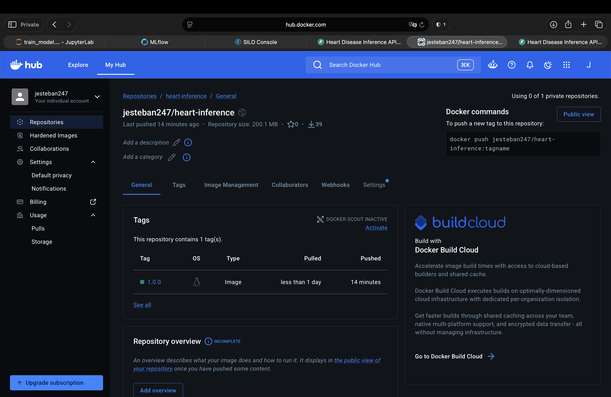

# Assignment 5

## Part 1 — Start services (VM)

```bash
cd /home/estudiante/mlops-course-repo/assignment5
cp .env.example .env
docker compose up -d --build --wait
```

## Part 2 — Train the model (Jupyter)

Jupyter — port `8888`:

```text
http://localhost:8888/lab
http://127.0.0.1:8888/lab
http://VM_IP:8888/lab
```

Default token: `assignment5-local` (`JUPYTER_TOKEN` in `.env`).

```text
train_model.ipynb → Run → Run All Cells
```

MLflow — port `5000`, no login:

```text
http://localhost:5000
http://127.0.0.1:5000
http://VM_IP:5000
```

MinIO console — port `9001`:

```text
http://localhost:9001
http://127.0.0.1:9001
http://VM_IP:9001
```

Default username: `assignment5-storage` (`AWS_ACCESS_KEY_ID` in `.env`).

Default password: `assignment5-storage-password` (`AWS_SECRET_ACCESS_KEY` in `.env`).

## Part 3 — Test the local API

Local API — port `8001`:

```text
http://localhost:8001/docs
http://127.0.0.1:8001/docs
http://VM_IP:8001/docs
```

```text
POST /predict → Try it out → Execute
```

## Part 4 — Publish the tested image (VM)

Set `API_IMAGE` in `.env`:

```dotenv
API_IMAGE=YOUR_DOCKERHUB_USER/heart-inference:1.0.0
```

```bash
set -a
source .env
set +a
docker tag assignment5-api:local "$API_IMAGE"
docker login
docker push "$API_IMAGE"
docker compose stop api-test jupyter
```

## Part 5 — Start one replica and Nginx (VM)

```bash
docker compose pull api nginx
docker compose up -d --wait --scale api=1 api nginx
```

Balanced API — port `8000`:

```text
http://localhost:8000/docs
http://127.0.0.1:8000/docs
http://VM_IP:8000/docs
```

Nginx requests:

```bash
docker compose logs -f nginx
```

CPU and memory during the test (another VM terminal):

```bash
docker stats
```

## Part 6 — Prepare Locust (Mac)

Copy only the `locust/` folder to the Mac. Use `VM_IP` from the Mac; `localhost` and `127.0.0.1` refer to the machine where the browser runs.

```bash
cd locust
conda create -n locust python=3.11 pip -y
conda activate locust
python -m pip install --require-hashes -r requirements.txt
cp .env.example .env
```

Set the reachable VM address in this folder's `.env`:

```dotenv
TARGET_HOST=http://VM_IP:8000
```

```bash
python run.py smoke
```

## Part 7 — Measure one replica (Mac)

Each command creates users at the specified `--spawn-rate` until the requested total, warms up for 15 seconds, then measures for 120 seconds and stops automatically. Users repeatedly send predictions, waiting 0.5–1.5 seconds between requests.

Results are saved automatically in `locust/results/`, with replica count, user count and a timestamp: `*_summary.json`, `*_window.json` and Locust CSV files. Acceptance: failures < 1% and p95 < 500 ms during the measured window; the expected replicas must respond using the same model.

```bash
python run.py load --replicas 1 --users 10 --spawn-rate 1
python run.py load --replicas 1 --users 25 --spawn-rate 1
python run.py load --replicas 1 --users 50 --spawn-rate 1
python run.py load --replicas 1 --users 100 --spawn-rate 1
```

If every level passes, continue increasing users. After the first failing level, try smaller increments between the last passing and first failing levels.

## Part 8 — Switch to three replicas

VM — create missing replicas, keeping the same image and model:

```bash
docker compose up -d --wait --scale api=3 api nginx
```

Mac — allow Docker DNS to refresh, then repeat with the same settings:

```bash
sleep 6
python run.py smoke
python run.py load --replicas 3 --users 10 --spawn-rate 1
python run.py load --replicas 3 --users 25 --spawn-rate 5
python run.py load --replicas 3 --users 50 --spawn-rate 5
python run.py load --replicas 3 --users 100 --spawn-rate 5
```

## Part 9 — Observed experiments

Results: [experiment_results/](experiment_results/). Click a user count in the table to open its JSON summary.

API and Nginx ran on the VM; Locust ran on the Mac. Each API replica was limited to 1 CPU and 1 GB. All runs used model version 1, a 15-second warmup after all users appeared, a 120-second measurement window, a 0.5–1.5-second wait between requests and a 10-second timeout.

A load passes if failures stay below 1% and p95 below 500 ms. One replica handled 100 users without errors, and three handled 200, but their responses were too slow to pass. Only the 10-user test passed both limits.

The table shows the 120-second measurement results.

| Replicas | Users / JSON | Spawn/s | Requests | RPS | Successful RPS | Failures % | p95 (ms) | Meets criterion |
|---:|---:|---:|---:|---:|---:|---:|---:|:---:|
| 1 | [10](experiment_results/rep1_u10_20261014T044548546305Z_summary.json) | 5 | 1,076 | 8.97 | 8.97 | 0.00 | 290 | Yes |
| 1 | [25](experiment_results/rep1_u25_20261014T044826336150Z_summary.json) | 1 | 1,760 | 14.67 | 14.67 | 0.00 | 1,500 | No |
| 1 | [50](experiment_results/rep1_u50_20261014T045138305275Z_summary.json) | 1 | 1,806 | 15.05 | 15.05 | 0.00 | 3,100 | No |
| 1 | [100](experiment_results/rep1_u100_20261014T045600899308Z_summary.json) | 2 | 1,681 | 14.01 | 14.01 | 0.00 | 7,100 | No |
| 1 | [150](experiment_results/rep1_u150_20261014T050333621945Z_summary.json) | 5 | 1,783 | 14.86 | 14.48 | 2.52 | 9,900 | No |
| 1 | [200](experiment_results/rep1_u200_20261014T045950083386Z_summary.json) | 5 | 2,179 | 18.16 | 0.00 | 100.00 | 10,000 | No |
| 3 | [100](experiment_results/rep3_u100_20261014T050849734735Z_summary.json) | 5 | 3,499 | 29.16 | 29.16 | 0.00 | 3,900 | No |
| 3 | [200](experiment_results/rep3_u200_20261014T051134144968Z_summary.json) | 5 | 3,527 | 29.39 | 29.39 | 0.00 | 7,500 | No |

One replica had no errors up to 100 tested users. Its highest successful throughput was 15.05 RPS at 50 users. At 150 users, 45 requests timed out; at 200, all measured requests timed out.

Three replicas handled 200 users at 29.39 RPS without errors, but p95 reached 7.5 seconds. Nginx spread requests almost equally across the three replicas.

Spawn rates differed, so the comparison is approximate. CPU and memory values in the JSON summaries belong to the Mac running Locust.

## Part 10 — Video demo

[](https://drive.google.com/file/d/1m2TQQkMNKHAQOX5ihGz_gYxu61uzdCfe/view?usp=share_link)

Click the image to watch the video.

## Part 11 — Workshop answers

1. **One replica:** 100 users completed without errors at **14.01 RPS**, but p95 was **7.1 seconds**. Only **10 tested users at 8.97 RPS** met the 500 ms target. The exact maximum needs more tests between 10 and 25 users.

2. **Three replicas:** 200 users completed without errors at **29.39 RPS**, but p95 was **7.5 seconds**. Neither tested load met the 500 ms target, so its sustainable maximum is still unknown.

3. **Improvement:** the highest tested load without errors doubled from 100 to 200 users. At 100 users, RPS increased by **108.2% (2.08×)**, below 3×. This shows better throughput, but not capacity within the latency target. Spawn rates differed.

4. **Bottleneck:** API processing appears to be the main limit: RPS stopped growing while response times increased and timeouts appeared. CPU is a possible cause. The Mac showed no CPU saturation warnings; its total CPU peak was **48.54%**. The exact resource causing the slowdown is still unknown.

5. **Other services:** Nginx, shared VM resources and the VPN could also limit performance. MLflow, PostgreSQL and storage are used to load the model, not for every prediction, but still consume VM resources. These results do not show which service caused the slowdown.

## Part 12 — Delete everything

```bash
docker compose --profile '*' down --volumes --remove-orphans
rm -f deployment/model.env
```