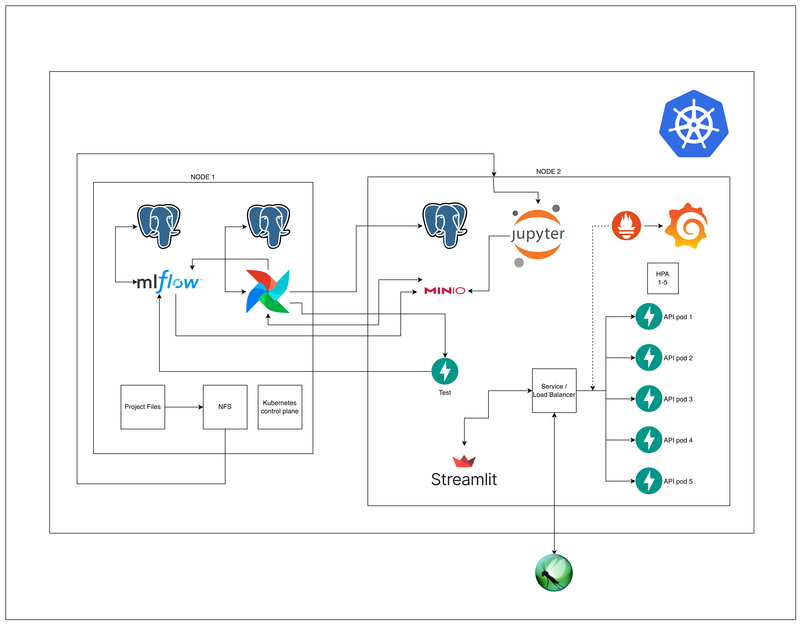
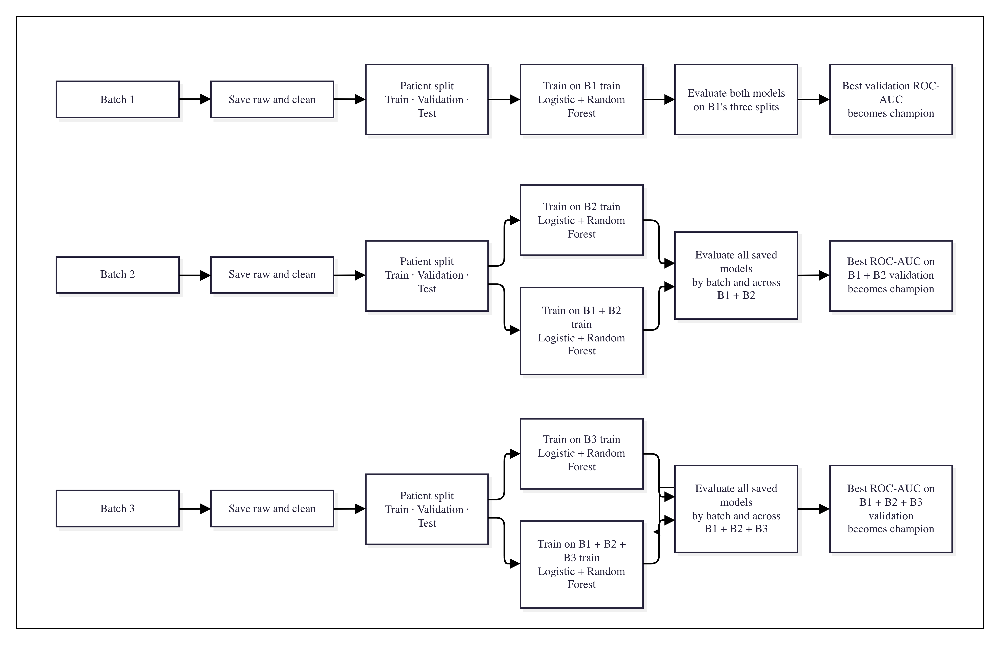

# MLOps Project 2

Diabetes readmission prediction using K3s, Airflow, MLflow, MinIO, FastAPI and Streamlit.

## Architecture

- **K3s:** NBAM07 runs the control plane; NBAM19 runs the worker workloads.
- **Jupyter and NFS:** Jupyter on NBAM19 reads and saves project files shared by the NFS server on NBAM07.
- **Airflow and storage:** Airflow runs the pipeline, reads batches from MinIO and saves raw and clean records in the application PostgreSQL database. Airflow has its own PostgreSQL database.
- **Airflow and MLflow:** Airflow logs training runs and evaluation metrics to MLflow. MLflow stores metadata in its PostgreSQL database and model artifacts in MinIO.
- **Airflow and the APIs:** When the champion changes, the DAG sends a reload request to the test and scaled APIs. The scaled API pods also check for model updates periodically.
- **Prediction:** The APIs load the champion through MLflow and save inference records in the application database. Streamlit calls the scaled API through its Kubernetes Service.
- **Scaling and monitoring:** The Service routes connections to ready API pods. The HPA adjusts the number of replicas using CPU; Prometheus collects pod metrics and Grafana displays them. Locust generates test traffic through an SSH tunnel to the Service.

## Training pipeline

- Each batch is stored as raw and cleaned records, then assigned to train, validation and test by patient. A patient's encounters stay in the same split across batches.
- The pipeline trains logistic regression and random forest models. From batch 2 onward, it trains on the current batch and on all accumulated batches.
- All saved models are evaluated on train, validation and test, both by batch and across accumulated batches. Metrics include accuracy, precision, recall, F1, ROC-AUC and average precision.
- The champion is the model with the highest **ROC-AUC on accumulated validation data**. Validation allows model comparison without using the training rows for selection; test metrics are reported but do not choose the champion.
- Runs and model versions are saved in MLflow. If the champion changes, Airflow notifies the APIs to reload it.

## Run the project

Follow [commands.txt](commands.txt) in order for setup, port forwarding, verification and cleanup. Configure credentials in `.env` using `.env.example`; keep `.env` private. The commands and manifests use these machines and their current addresses:

- **NBAM07 — 10.43.97.96:** K3s control plane, Airflow, MLflow and shared project files.
- **NBAM19 — 10.43.97.108:** Jupyter, MinIO, application database, APIs, Streamlit and monitoring.

Run notebooks 01–04, then notebook 05 or the Airflow DAG for a batch. Do not run notebook 05 and the DAG simultaneously. Notebook 06 inspects the database.

## Resources

Values are CPU and memory **requests / limits per container**. `1000m` CPU equals one CPU. Airflow scheduler and DAG processor pods also have a log-groomer sidecar listed below.

| Container | Node | CPU request / limit | Memory request / limit |
|---|---|---:|---:|
| Airflow scheduler | NBAM07 | 150m / 2 | 1Gi / 3Gi |
| Airflow DAG processor | NBAM07 | 100m / 1 | 256Mi / 1Gi |
| Airflow API server | NBAM07 | 100m / 1 | 256Mi / 1Gi |
| Airflow PostgreSQL | NBAM07 | 100m / 1 | 256Mi / 1Gi |
| Airflow log-groomer sidecar, each | NBAM07 | 10m / 200m | 32Mi / 128Mi |
| Airflow migration and user-creation jobs, each | NBAM07 | 100m / 1 | 256Mi / 1Gi |
| Airflow StatsD | Scheduler-selected | 10m / 200m | 64Mi / 256Mi |
| MLflow | NBAM07 | 150m / 2 | 1Gi / 3Gi |
| MLflow PostgreSQL | NBAM07 | 100m / 1 | 192Mi / 768Mi |
| Jupyter | NBAM19 | 150m / 1 | 384Mi / 2Gi |
| MinIO | NBAM19 | 100m / 1 | 256Mi / 1Gi |
| Application PostgreSQL | NBAM19 | 100m / 1 | 192Mi / 768Mi |
| Test API | NBAM19 | 100m / 1 | 256Mi / 2Gi |
| Scaled API, each replica | NBAM19 | 250m / 1 | 512Mi / 1500Mi |
| Streamlit | NBAM19 | 100m / 1 | 256Mi / 768Mi |
| Prometheus | NBAM19 | 100m / 1 | 256Mi / 1Gi |
| Grafana | NBAM19 | 100m / 1 | 256Mi / 768Mi |

The scaled API HPA runs 1–5 replicas with a 70% CPU utilization target.

## Load tests

[Locust instructions](locust/README.md) · [Results and analysis](locust/results/REPORT.md)

## Video

