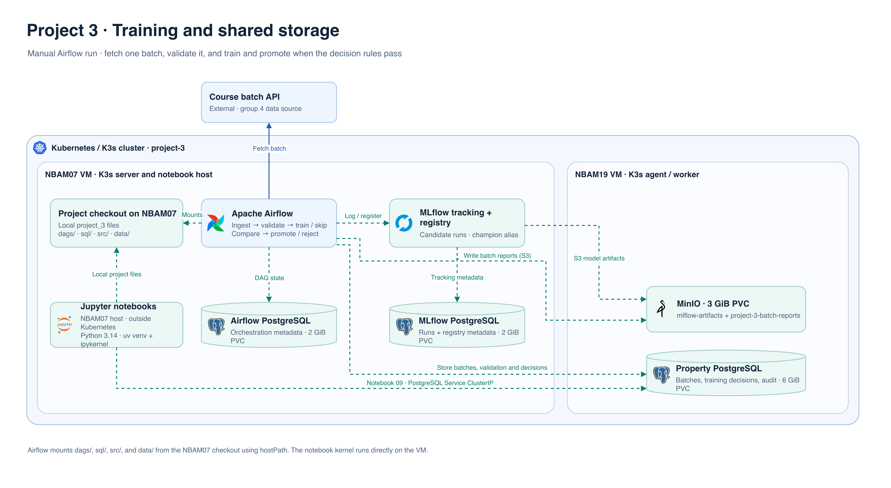
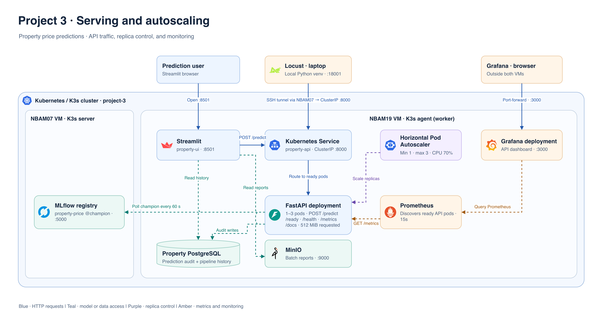
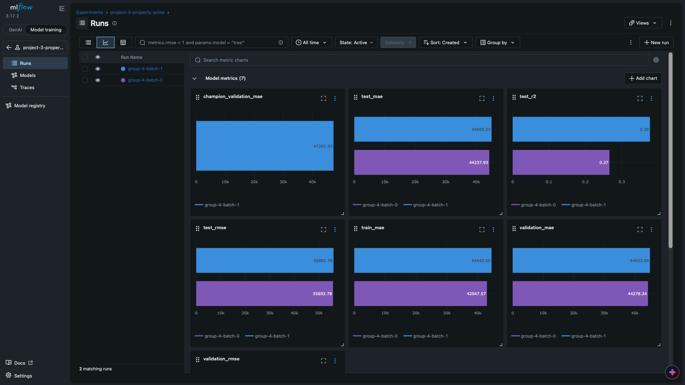
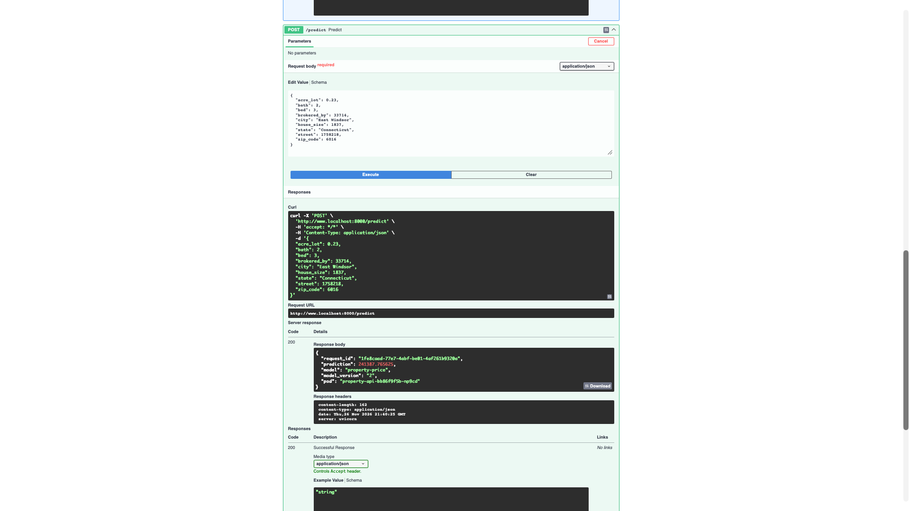
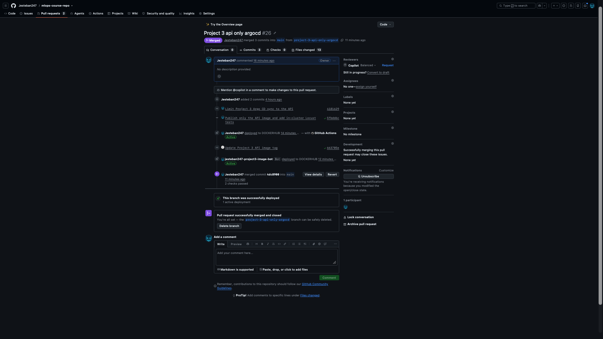
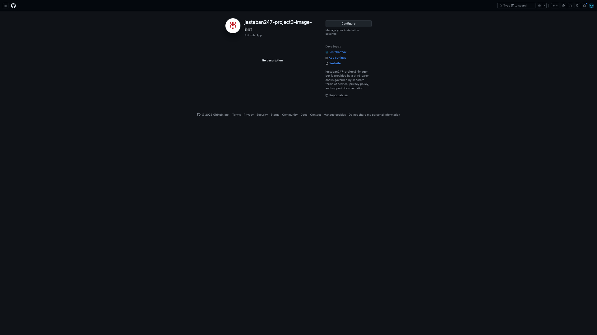
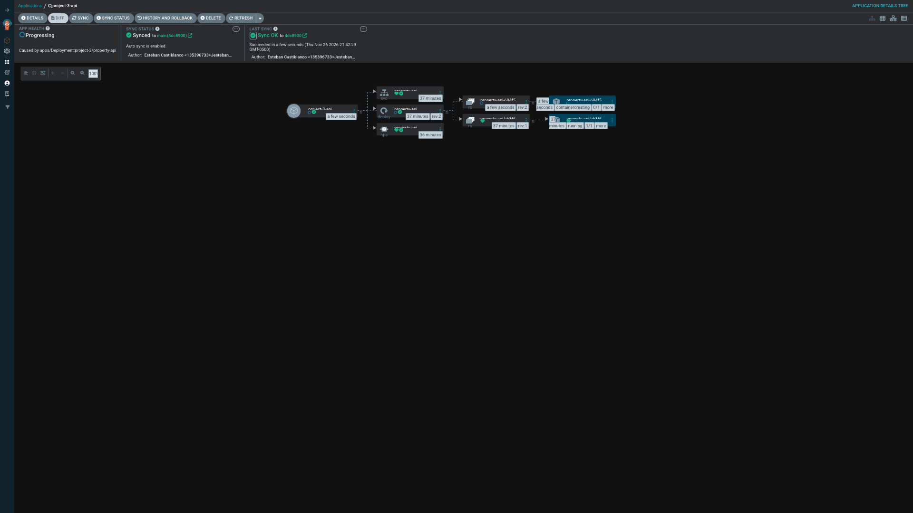
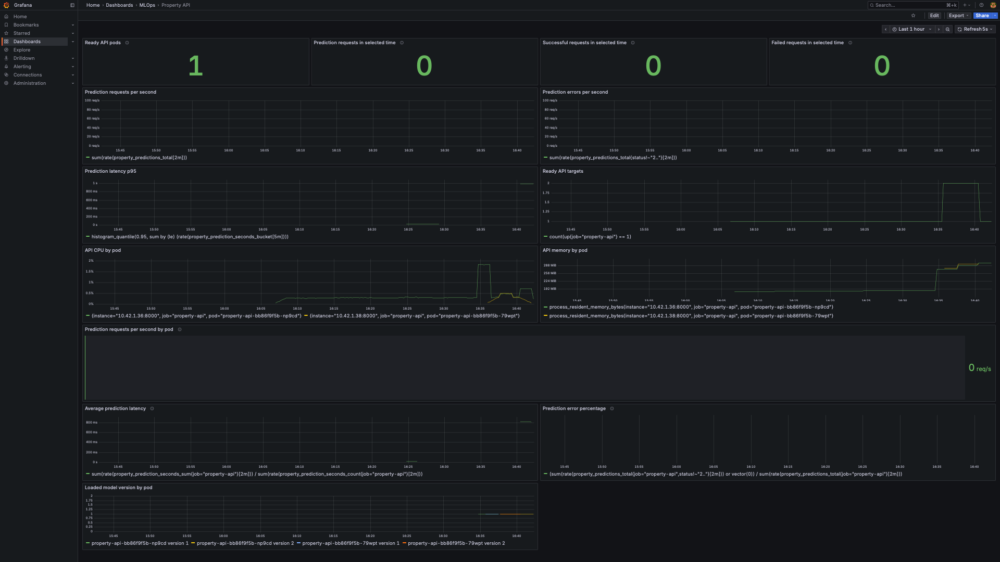
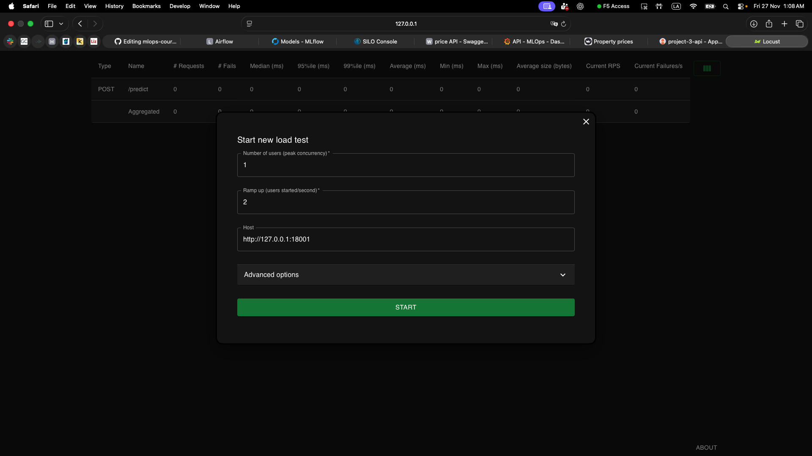

# Project 3 — Property Price Prediction

## Project structure

```text
project_3/
├── api/
├── argocd/
├── dags/
├── evidence/
├── k8s/
├── locust/
├── notebooks/
├── scripts/
├── sql/
├── src/
│   └── property_ml/
├── streamlit/
├── tests/
├── .env.example
├── commands.md
└── README.md
```

## Project demo

**YouTube** · Link pending.

## Architecture



**Training.** Airflow processes one batch per run. PostgreSQL stores the data and decisions, MLflow registers the models, and MinIO stores artifacts and reports.



**Inference.** Streamlit and Locust reach the API through its Kubernetes Service. The HPA scales the replicas, and Grafana displays metrics from Prometheus. The diagram shows a `512Mi` memory request. The [current manifest](k8s/api/api.yaml) specifies `384Mi`.


**CI and GitOps.** GitHub Actions publishes the API image, and Argo CD syncs the API manifests from `main`.

## 1 · Kubernetes deployment

- [Installation and testing guide](commands.md)
- [Commands run on NBAM07](evidence/commands_NBAM07.txt)
- [Commands run on NBAM19](evidence/commands_NBAM19.txt)


**K3s cluster.** Running pods, bound volumes, and an HPA configured for one to three replicas.

## 2 · Ingestion and validation in Airflow


**Airflow.** The DAG ran ingestion, validation, training, model comparison, and promotion.


**PostgreSQL.** The [database inspection notebook](notebooks/09_database_inspection.ipynb) shows batches 0 and 1, with 168,335 rows in each of RAW and CLEAN, and the history of model decisions and predictions.


**Data drift.** The report compares the `house_size` distribution for batch 1 with that of earlier batches.

## 3 · Training and model registry



**MLflow experiments.** Training, validation, and test metrics for batches 0 and 1.


**Model registry.** MLflow retains versions 1 and 2. The `champion` alias points to version 2.


**MinIO.** The buckets contain MLflow artifacts and batch reports.

## 4 · Predictions and history



**FastAPI.** The response shows the prediction, the pod, and model version 2. The database inspection notebook shows predictions from versions 1 and 2 served by the same pod.


**Streamlit.** The form shows a predicted price of 241,387.77 using version 2.


**Batch 1 history.** The candidate was promoted after reducing MAE on the same validation set from 47,261.43 to 44,933.59. The history shows the reason and the MLflow run.

## 5 · Image publishing and GitOps sync

- [GitHub Actions workflow](../.github/workflows/project-3-ci.yml)
- [PR #26](https://github.com/Jesteban247/mlops-course-repo/pull/26) · [Bot commit](https://github.com/Jesteban247/mlops-course-repo/commit/663705e) · [Docker Hub tag](https://hub.docker.com/r/jesteban247/project-3-property-api/tags?name=sha-5fbdd6c65d8d68357bc677f1a12b0fcbe46813d9)



**API image publishing.** The PR shows passing checks and the automated tag update.



**Image bot.** The GitHub App updates the API image tag in the PR.



**Argo CD.** Revision `4dc8900` is `Synced`. At the time of the capture, the new pod was still starting and health showed `Progressing`.

## 6 · Observability and load testing



**Grafana.** The dashboard shows traffic, latency, errors, replicas, CPU, memory, and model version. The request counters show zero for the selected interval.



**Locust.** The [load test](locust/README.md) was configured, with zero requests at the time of the capture.

The [YouTube demo](#project-demo) will show a Locust load test alongside Grafana, the API rollout reaching `Synced` and `Healthy` in Argo CD, and an Airflow run that skips retraining.
