# Project 3 · Property Price Prediction

This project processes one real-estate batch per Airflow run, decides whether the new data warrants retraining, and promotes a candidate only when it improves on the model currently serving predictions. FastAPI polls the MLflow registry for the champion, and Streamlit exposes predictions and batch history.

**Video demonstration:** YouTube link pending. The recorded walkthrough covers the Airflow skip branch, a Git change synced by Argo CD, and a Locust run with API scaling and requests distributed across pods in Grafana.

[Architecture](#architecture) · [Batch decisions](#batch-decisions) · [Model and inference](#model-training-promotion-and-inference) · [CI and GitOps](#ci-and-gitops) · [Load test](#observability-and-load-testing) · [Runbook](commands.md)

## Architecture

The K3s cluster has two VMs. **NBAM07** runs the K3s control plane, Airflow, MLflow, and their PostgreSQL backends. Airflow mounts the project checkout, and the Jupyter kernel runs directly on the NBAM07 host for data exploration and database inspection. **NBAM19** runs the API, Streamlit, property PostgreSQL, MinIO, Prometheus, and Grafana. Locust runs on the tester's laptop and connects to the API Service through an SSH tunnel via NBAM07.

*Training and storage. Airflow writes batch data and decisions to PostgreSQL. MLflow uses PostgreSQL for metadata, and MinIO stores model artifacts and batch reports.*

*Serving. Streamlit calls the API Service, and the Service routes requests to ready pods. The diagram records an earlier `512Mi` memory request. The current Deployment requests `384Mi` per API pod.* [Current manifest](k8s/api/api.yaml) · [Memory adjustment in PR #30](https://github.com/Jesteban247/mlops-course-repo/pull/30)

## Batch decisions

Airflow fetches one batch from the course API, stores the original payload in RAW, validates and deduplicates rows into CLEAN, and saves a decision in `audit.batch_decisions`. The audit record includes the run ID, reason, data quality and drift metrics, and the report location in MinIO. The first valid batch can train the baseline. Subsequent training requires enough valid and novel data, at least **5%** additional valid data relative to the reference, and a change signal. The current change thresholds are **PSI ≥ 0.20** or **at least 5% new values** in a decision category such as city, state, or status. The contribution threshold limits retraining on shifts observed in a small batch while keeping its rows available for the next evaluation. [DAG](dags/property_pipeline.py) · [Decision rules](src/property_ml/decisions.py) · [Audit and reports](src/property_ml/batch_decisions.py) · [RAW, CLEAN, and audit schemas](sql/01_schema.sql)

### Explore the rule on five saved batches

[Notebook 07](notebooks/07_compare_batches.ipynb) inspects schema, duplicates, distributions, and unseen categories. [Notebook 08](notebooks/08_retraining_decisions.ipynb) simulates the decision sequence on the saved batches. Its rows describe the data available for a decision before the train, validation, and test split.

| Batch | Incoming rows | Pending valid data / reference | Maximum PSI | Simulated decision and reason |
|---|---:|---:|---:|---|
| 0 | 73,784 | — | — | Train the initial baseline. |
| 1 | 94,551 | 128.15% | 12.464 | Train on the shift in house size and new cities. |
| 2 | 230,366 | 136.85% | 0.006 | Train because new status values cross the category threshold. |
| 3 | 4,055 | **1.02%** | **0.209** | **Accumulate.** The drift threshold was met, but the contribution was below 5%. |
| 4 | 320,696 | 81.45% | 0.596 | Train on the house-size shift after accumulating **324,751** pending valid rows from batches 3 and 4. |

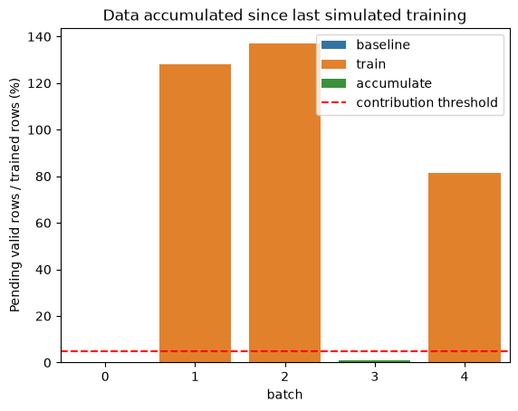

*Saved Notebook 08 output. Batch 3 falls below the dashed contribution threshold. The Airflow branch for this outcome is `skip_training`, which keeps the batch available for later evaluation.*

### Inspect the executed pipeline

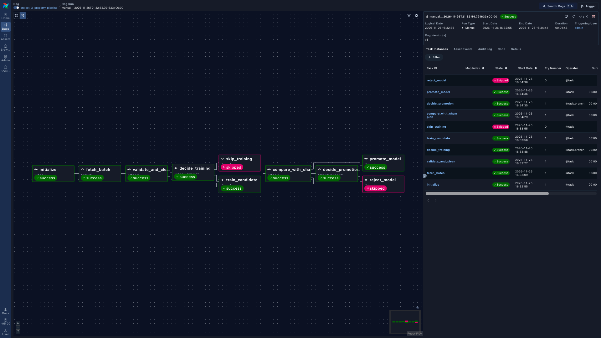

*Airflow evidence. This captured run selected training and promotion. The skip case is covered in the recorded walkthrough.*

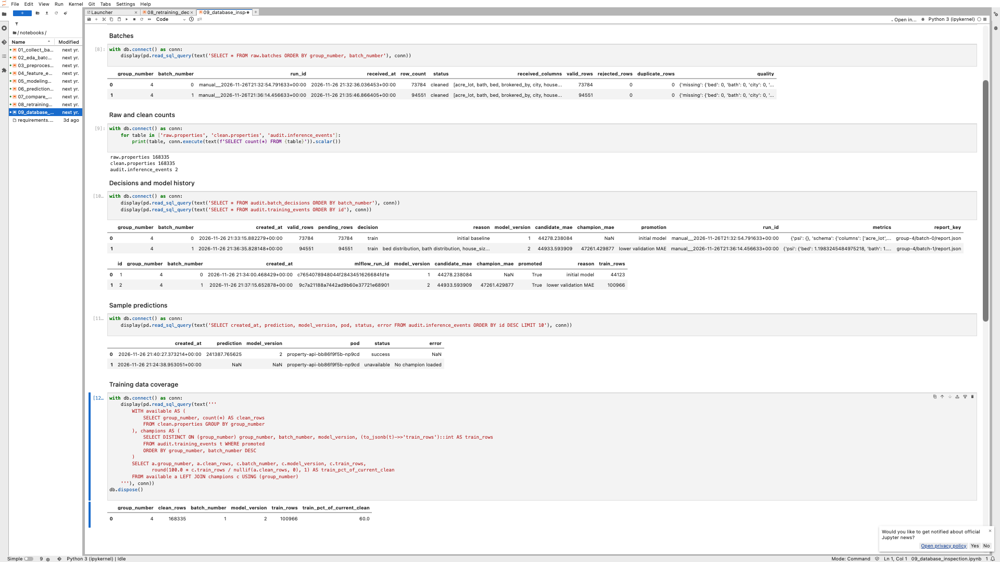

*The saved [database inspection notebook](notebooks/09_database_inspection.ipynb) shows the audited runs for batches 0 and 1, with 168,335 rows in each of RAW and CLEAN, plus versioned inference events.*

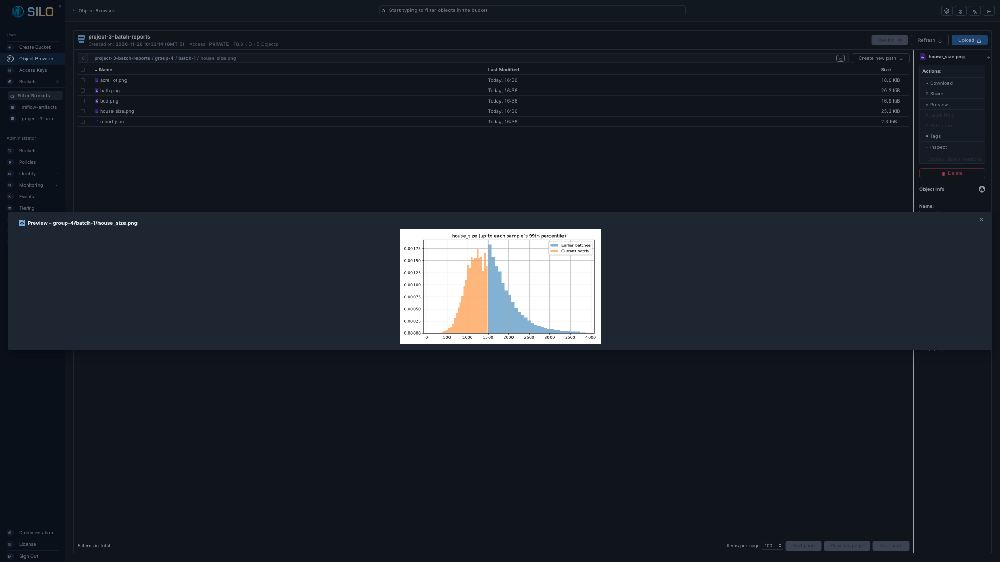

*The batch 1 report shows a change in the house-size distribution. The audit record connects the report to the batch and its decision.*

## Model training, promotion, and inference

The [model comparison notebook](notebooks/05_modeling_batch_0.ipynb) selected XGBoost without listing status or previous sale date. Its validation MAE on batch 0 was **44,278.24**, compared with **52,916.83** for the median baseline and **44,041.06** for XGBoost with those contextual fields. The small gain from those fields did not justify relying on them for the inference contract. The [pipeline](src/property_ml/features.py) handles unseen categories and uses a [stable 60/20/20 split](src/property_ml/splitting.py) based on a property proxy to reduce overlap between splits. MAE is the promotion metric because its error is expressed in the target's price units. MLflow also logs RMSE for validation and test, test R², model and preprocessing parameters, training reason, the code revision, and artifacts such as SHAP importance.

The [promotion task](src/property_ml/training.py) evaluates the candidate and the current champion on the **same validation rows**. Batch 0 registered and promoted version 1 as the baseline. In the batch 1 run, the candidate lowered MAE from **47,261.43 to 44,933.59**, an improvement of **4.9%**, and became version 2 of the `champion` alias. The batch 0 MAE above comes from its own validation run. The batch 1 comparison re-evaluates both models on the batch 1 run's validation set.

*MLflow experiment metrics for the first two recorded pipeline runs.*

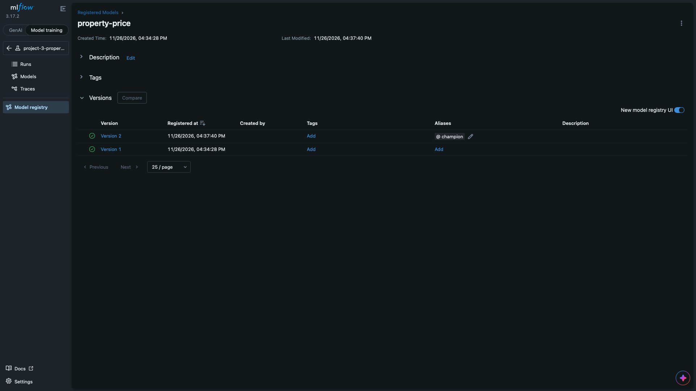

*The Model Registry retains versions 1 and 2. At the time of the capture, version 2 held the `champion` alias.*

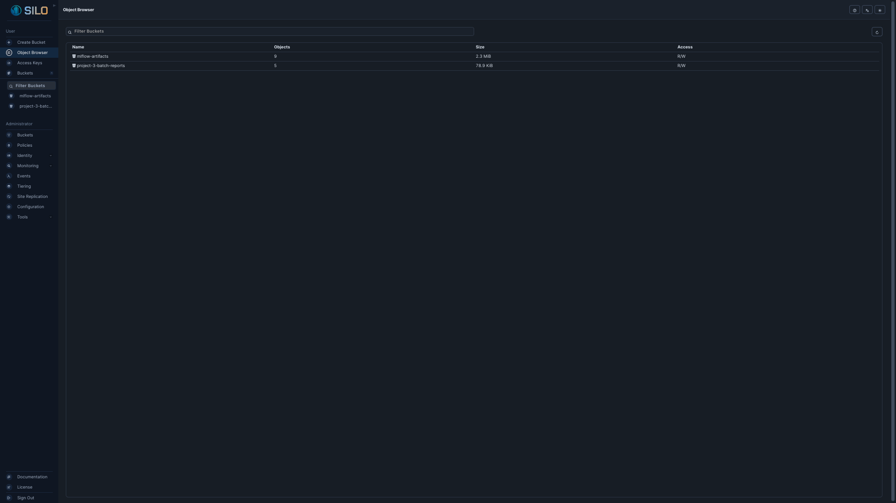

*MinIO stores model artifacts and batch reports in separate buckets.*

FastAPI polls the alias every 60 seconds. It loads the new model before swapping the model and version together under a lock. If loading fails, the running pod keeps serving its previous model. The audit notebook records successful responses from **the same pod** using versions **1 and 2**, evidence of a model update without replacing that pod. The inference endpoint records prediction, model version, pod, status, and error details in PostgreSQL. [Reload and inference code](api/main.py) · [Saved inference events](notebooks/09_database_inspection.ipynb)

*FastAPI returns the predicted price, model version, and the pod serving the request.*

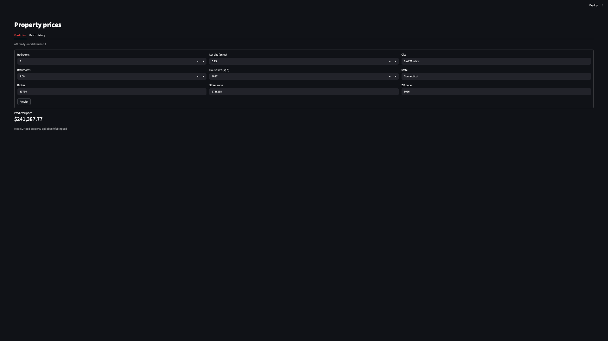

*Streamlit displays a prediction of 241,387.77 with model version 2.*

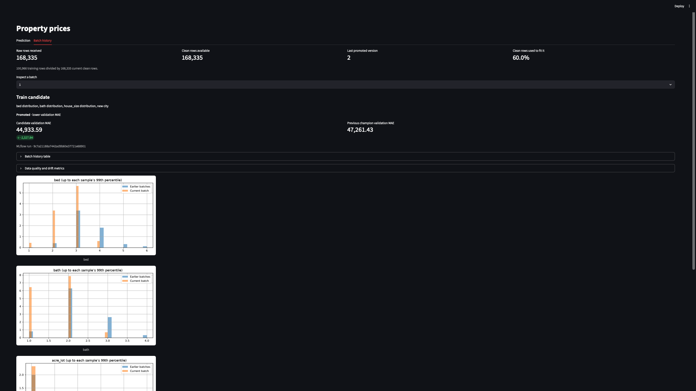

*Streamlit shows the candidate and champion MAE, the promotion decision, and the associated MLflow run.*

## CI and GitOps

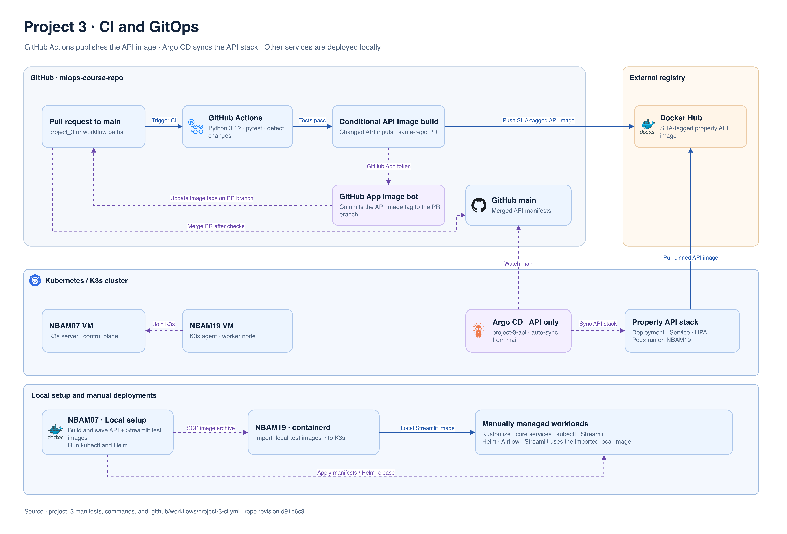

*Deployment flow. Argo CD reconciles the API from `main`. Streamlit, Airflow, and core services use the documented deployment commands.*

| Stage | What runs | Evidence |
|---|---|---|
| Pull request | GitHub Actions runs `pytest`. After tests pass, PRs from the same repository publish an API image if its build inputs changed. Docker Hub stores the image with a `sha-<commit>` tag. | [Workflow](../.github/workflows/project-3-ci.yml) · [PR #26 run](https://github.com/Jesteban247/mlops-course-repo/actions/runs/45929607195) |
| Manifest update | A GitHub App token allows `project-3-image-bot` to commit the published tag to `k8s/api/api.yaml` on the PR branch. The workflow verifies the branch still points to the build commit before writing the tag. | [Bot commit](https://github.com/Jesteban247/mlops-course-repo/commit/663705e) · [Published API tag](https://hub.docker.com/r/jesteban247/project-3-property-api/tags?name=sha-5fbdd6c65d8d68357bc677f1a12b0fcbe46813d9) |
| Merge and reconciliation | Argo CD watches `main` and automatically syncs the API Deployment, Service, and HPA. It respects the replica count managed by the HPA. A manifest-only change can sync without building an image when the image inputs are unchanged. | [Argo CD application](argocd/api.yaml) · [Manifest-only memory change in PR #30](https://github.com/Jesteban247/mlops-course-repo/pull/30) |

*PR #26 shows the passing checks and the bot's manifest update. [GitHub App configuration capture](evidence/14-image.png).*

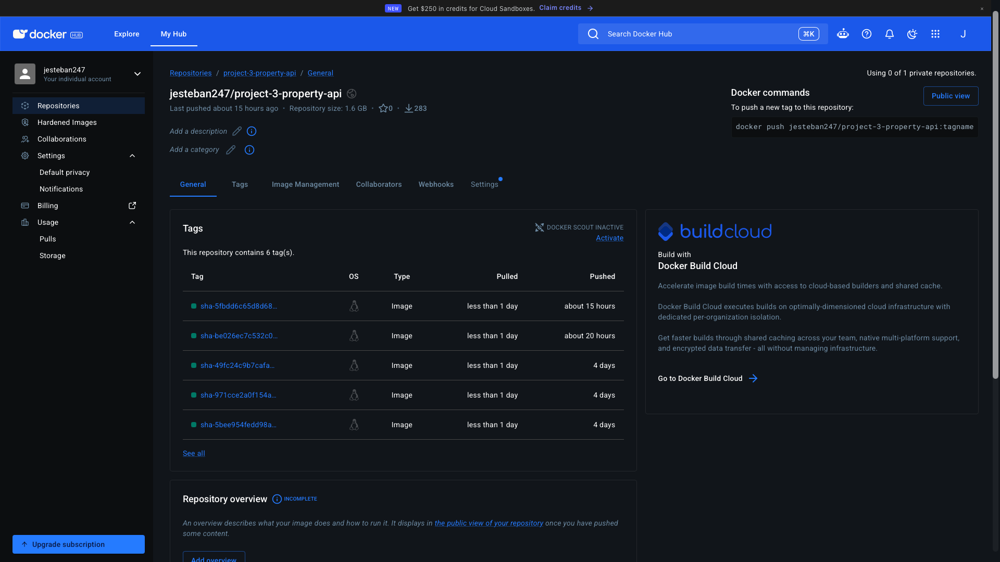

*The API repository contains versioned images. The top tag begins with `sha-5fbdd6c`, matching the tag written by the bot in PR #26.*

*Argo CD reports revision `4dc8900` as `Synced`. The API health still shows `Progressing` in this capture. The recorded walkthrough shows a Git change being synced live.*

### Why the deployment scope changed

The initial setup defined Argo CD applications for the API, Streamlit, Airflow, and core services. In PR #25, Actions published both application images and the bot updated both manifests. During deployment, the team limited automatic reconciliation to the API because of capacity constraints on the course VMs. The runbook documents a check on available space in NBAM19 before unpacking the API image. PR #26 removed the other Argo CD applications and kept API publishing. Streamlit, Airflow, and core services follow the documented manual workflow using host-local images, Helm, or `kubectl` as appropriate. [PR #25](https://github.com/Jesteban247/mlops-course-repo/pull/25) · [Published Streamlit tag](https://hub.docker.com/r/jesteban247/project-3-property-ui/tags?name=sha-be026ec7c532c08973d37da003688776246aa894) · [PR #26](https://github.com/Jesteban247/mlops-course-repo/pull/26) · [Deployment runbook](commands.md#15-enable-argo-cd-sync--nbam07)

## Observability and load testing

Prometheus discovers ready API pods and scrapes `/metrics` every 15 seconds. The [versioned Grafana dashboard](k8s/monitoring/monitoring.yaml) shows request rate, latency, errors, ready pods, process CPU and memory, and model version by pod. The [API manifest](k8s/api/api.yaml) requests **100m CPU and 384 MiB** per pod and limits it to **1 CPU and 2 GiB**. The [HPA](k8s/api/hpa.yaml) uses average CPU utilization with a **70% target** and a range of **1–3 replicas**.

Locust sends prediction requests from the laptop through the SSH tunnel to the Kubernetes API Service. In the walkthrough, Grafana shows the API scaling under load and requests reaching multiple pods. The stills below document the working dashboard and Locust setup before generating traffic. Use the walkthrough to assess the load response and the [Locust runbook](locust/README.md) to reproduce the test.

*Grafana before the load test. The request counters show zero for this interval.*

*Locust setup. The target is the local SSH forward at `127.0.0.1:18001`. The capture was taken before requests were sent.*

## Reproduce the deployment

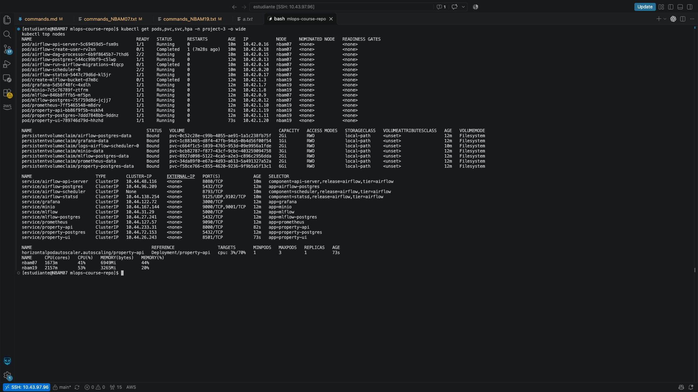

*Cluster evidence. The output shows pod placement, services, bound storage, and the configured HPA.*

- [Install and test on the two VMs](commands.md)
- [NBAM07 command log](evidence/commands_NBAM07.txt) and [NBAM19 command log](evidence/commands_NBAM19.txt)
- [Notebook environment](notebooks/README.md) and [Locust instructions](locust/README.md)
- [Automated tests](tests), [Kubernetes manifests](k8s), and [environment template](.env.example)
